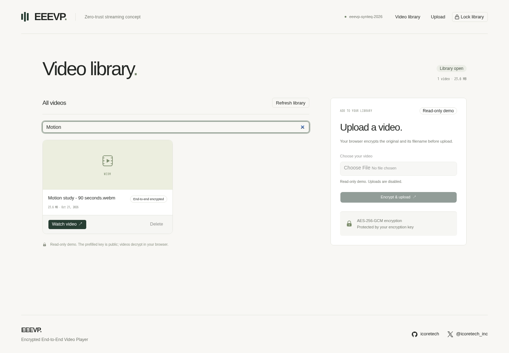
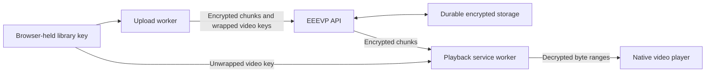
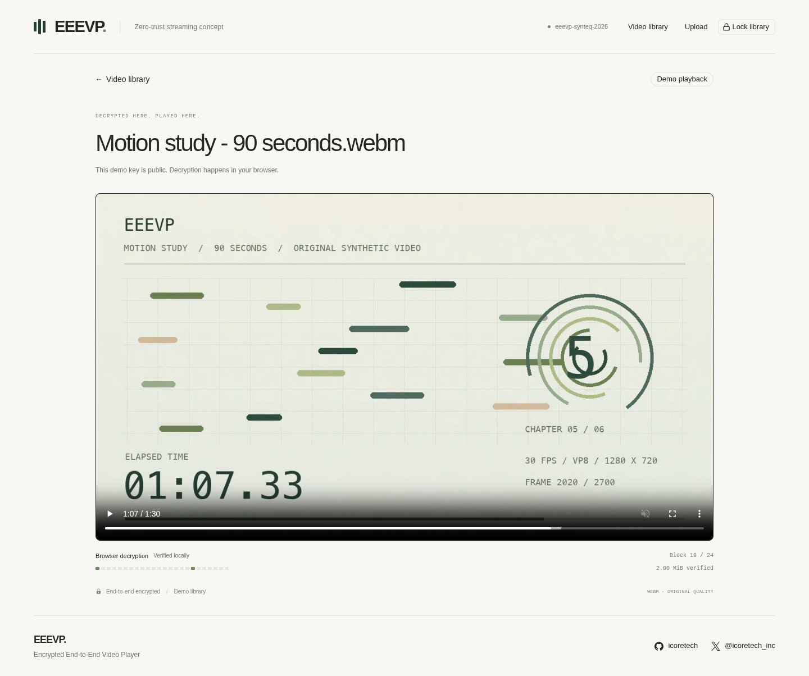

# EEEVP

**Tech demo for [Synteq Hackathon 2026](https://synteq.com/hack).**

**Zero-trust streaming concept. Encrypt before upload. Decrypt while watching.**

**[Open the demo](https://eeevp.synteq.app)** · [Source repository](https://github.com/icoretech/eeevp) · **Open source · [MIT License](LICENSE)**

EEEVP means **encrypted end-to-end video player**. Enter a key to open your library. The matching encryption key reveals filenames and plays the videos; a wrong key leaves encrypted names unreadable. Video content and filenames are encrypted before upload, and the browser decrypts the bytes needed for playback and seeking.

Public demo mode is read-only and uses synthetic samples with an intentionally public key prefilled in an editable field. Its gate shows the key and login action; import and generation tools are hidden. Use the prefilled key to watch, or change it to see unreadable encrypted names. Private use requires a different key and storage namespace.

[Official challenge announcement](https://x.com/synteq/status/2112626108231254140) · [iCoreTech entry announcement](https://x.com/icoretech_inc/status/2112644881780818180) · [Event rules](https://hack.synteq.app/rules)



*Read-only demo with a synthetic 90-second `Motion study` sample: 23.6 MiB across 24 encrypted chunks.*

## Run the demo

Install Docker with Docker Compose. Keep `DEMO_MODE=false` for local development, set a random server session secret, and keep the private encryption key and recovery copy in a trusted place:

```sh
cp .env.example .env.development
${EDITOR:-vi} .env.development
docker compose up --build -d
```

Open [localhost:3000](http://localhost:3000). Enter your **Encryption key** and select **Decrypt & Login**. To import a recovery `.txt` file, expand **Advanced key tools**, which starts collapsed in private mode. Any nonempty key opens the catalog. The server does not receive or check the entered key; only the matching key can decrypt filenames and video content. The public demo's key is deliberately known and prefilled. Use a private library's own key on another device to open its encrypted catalog.

For a new empty private library, **Advanced key tools → Generate a new library key** creates and downloads a recovery file locally. Existing videos still require their original key. These advanced tools are absent from public demo mode.

## Demo features

- **A video library.** Browse and search decrypted filenames in the browser. Private-use mode enables uploads and confirmed deletion; public demo mode blocks every library mutation on the server.
- **Encryption before upload.** A dedicated web worker encrypts 1 MiB video chunks and filename/type metadata with AES-256-GCM. Each random video key is wrapped under the library key.
- **Decryption while watching.** A service worker fetches encrypted chunks, authenticates them, and streams the requested plaintext ranges to the native video player.
- **Real verification activity.** A discreet fixed-height HUD shows unique AES-GCM-verified chunks, MiB, and the last verified block from service-worker events. Repeated seeks pulse on actual verification without inflating unique coverage.
- **Private keys stay local.** Private keys and imported recovery files are not submitted to the server. The public demo key is intentionally prefilled; a wrong key leaves the catalog unreadable.
- **Focused multimedia POC.** The same browser boundary can inform future AudioBox Enterprise workflows; this POC ships video only.

## How browser encryption works



The API opens a convenience session with an HttpOnly cookie. It does not check the browser's encryption key. The browser unwraps each video's key and decrypts its metadata locally. The library key remains in memory across navigation; reload requires re-entry, and **Lock library** clears the key and session.

### Why chunked browser streaming

Video is large enough to expose the difference between encrypting a finished file and serving a useful player. EEEVP encrypts 1 MiB chunks as the upload worker reads them, then the service worker decrypts only the ranges requested by the native player. That keeps memory bounded, makes byte-range seeking meaningful, and lets the storage layer hold ciphertext throughout the flow. The 90-second, 23.6 MiB synthetic WebM spans 24 chunks, with valid duration and cues for range tests; fixture preparation is test data, not server transcoding.

MP4 and WebM files up to 2 GiB play in their original quality, using codecs supported by the viewer's browser. The app performs no server-side transcoding or FFmpeg processing and has no server media job queue. Lost private keys cannot be recovered. The server observes structural metadata such as sizes and access timing; delivered app JavaScript and unlocked devices must be trusted.

Public demo mode demonstrates the encryption mechanics with a deliberately known key and server-enforced read-only samples. In private-use mode, content confidentiality depends on the private browser-held key. The session cookie is not proof of key possession: when `DEMO_MODE=false`, a caller can open a session and invoke mutation APIs without the key. See the [security model](docs/security.md) and [architecture](docs/architecture.md) for integrity and availability limits.

## Threat model

| Boundary | What EEEVP protects | What remains visible or possible |
| --- | --- | --- |
| Server seizure or passive storage snapshot | Private ciphertext, wrapped video keys, and encrypted names remain unreadable without the private library key | Object IDs, sizes, chunk counts, timestamps, and access patterns remain observable |
| Provider-managed encryption | R2 adds automatic AES-256 encryption at rest to the browser ciphertext | Provider-managed keys are an additional at-rest layer, not the application privacy boundary; client-side AES-GCM keeps plaintext out of the storage path |
| Network observer | HTTPS/TLS protects transport against eavesdropping, tampering, and forgery | A compromised endpoint, active proxy, or leaked TLS endpoint can still observe requests |
| Browser/application compromise | Authenticated AES-GCM rejects modified or misbound ciphertext | Malicious delivered JavaScript, extensions, an unlocked device, or an authorized viewer can read or copy plaintext |
| Public demo mode | Server blocks all five library mutation routes and serves only seeded synthetic samples | The demo key is intentionally public; its content is not confidential |
| Writable private mode | Browser encryption keeps private media and names out of passive storage | The convenience session is not key possession; an opened session can invoke mutation APIs, so integrity and availability need deployment-level controls |

HTTPS is required for session transport and service-worker playback. Browser AES-GCM remains the content boundary after transport termination: a passive observer who obtains TLS session material still sees AES-GCM ciphertext unless it also obtains the private browser key. Active JavaScript or an endpoint compromise can capture the key or plaintext.

The design is motivated by exploring browser-encrypted multimedia delivery for future AudioBox Enterprise users. It is a focused video POC; audio, images, and other media types are not implemented here.

## Stack

| Layer | Technology |
| --- | --- |
| Application | Next.js 16 App Router, React 19, TypeScript 7 |
| Interface | shadcn/ui with Base UI, Tailwind CSS 4 |
| Motion | Native React 19.3 `ViewTransition`, Next.js Link transition types |
| Browser cryptography | Web Crypto, AES-256-GCM, Web Worker |
| Streaming | Service Worker, HTTP byte ranges, native HTML video |
| Validation | Zod 4 |
| Local development storage | Atomic files on a persistent Compose volume |
| Hosted runtime | Synteq Apps with one fixed Cloudflare R2 bucket |
| Object API | AWS SDK for JavaScript v3, R2 S3-compatible API |
| Runtime and packaging | Node.js 26, Yarn 4, Next.js standalone Docker image |
| Verification | Vitest, Playwright Chromium and Firefox, Biome, React Doctor |

Motion respects reduced-motion preferences and keeps normal navigation when the native browser API is unavailable.

The decryption HUD reserves 56 px and displays at most 32 cells, with UI notifications limited to 5 Hz. It reports successful authenticated decryptions, not estimated fetching/decryption phases. It stays static when idle, respects reduced motion, and exposes no keys, plaintext, filenames, or source URLs in its metrics.



## Deployment on Synteq

The [live demo](https://eeevp.synteq.app) runs on **one Synteq App and one fixed Cloudflare R2 bucket**. Synteq builds the repository's Dockerfile and provides HTTPS; the image packages the worker and Next.js standalone server, with `/api/health` for readiness. The bucket is deployment configuration, with no bucket selector in the application. No Serverless Functions are implemented.

Production demo configuration uses `DEMO_MODE=true` and a dedicated intentionally public `DEMO_PUBLIC_KEY`. The UI prefills that key without hardcoding it in source. The server returns `403` for initialization, upload, chunk writes, completion, and deletion; reading, searching, and playback remain available.

The [Apps runtime](https://cloud.synteq.com/docs/apps-overview#runtime-environment) uses a temporary local filesystem. The hosted app therefore keeps the encrypted catalog, video chunks, library descriptor, and deletion markers in R2. Local development uses the persistent filesystem volume in Docker Compose. Follow the [deployment guide](docs/deployment.md) for configuration and verification.

The [event rules](https://hack.synteq.app/rules) require a live `<name>.synteq.app` URL. Platform background: [Synteq Apps and Serverless Functions launch announcement — October 20, 2026](https://synteq.com/blogs/introducing-synteq-apps-and-serverless-functions).

## Development checks

Run tooling inside the Compose service:

```sh
docker compose exec -T web yarn biome:check
docker compose exec -T web yarn typecheck
docker compose exec -T web yarn react-doctor:ci
docker compose exec -T web yarn test
```

For writable browser acceptance, use `DEMO_MODE=false` and the matching recovery file for an initialized local development library containing a playable video larger than 1 MiB. The runner preserves existing data, creates its own test video, and removes that video afterward. Pass the recovery text through stdin; keep the file outside the repository.

Install the browser engines and system dependencies first; repeat after recreating the development container:

```sh
docker compose exec -T web yarn playwright install --with-deps chromium firefox
docker compose exec -T web node tests/browser/run-private-library.mjs < /path/to/recovery-key.txt
```

The read-only Firefox regression waits 35 seconds before native playback, then checks seeking, a range across encrypted chunks, and locking:

```sh
docker compose exec -T web node tests/browser/run-private-library.mjs tests/browser/playback-idle.spec.ts --browser=firefox < /path/to/recovery-key.txt
```

Verification coverage:

| Boundary | Checks |
| --- | --- |
| Writable local mode | [Chromium workflow](tests/browser/video-flow.spec.ts): upload, opaque wrong-key catalog, playback, key-local network behavior, and deletion |
| Firefox | [Idle playback](tests/browser/playback-idle.spec.ts): 35-second idle recovery, native play, seek, cross-chunk `206`, and post-lock `403` |
| Interface motion | [Native transitions](tests/browser/page-transitions.spec.ts): forward/back animation frames, deferred catalog search, reduced motion, urgent lock interruption, and Firefox navigation without the native API |
| Live R2 | [Object IO](tests/integration/r2-object-store.test.ts) and [library records](tests/integration/storage-s3.test.ts): competing immutable writes, paginated listing, bounded reads, new-instance visibility, completion, and deletion markers |
| Read-only APIs | [Demo mode](tests/integration/demo-mode.test.ts): all five library mutation routes return `403`, seeded files remain unchanged, and sessions and reads remain available |
| Decryption HUD | [Real activity](tests/demo-browser/decryption-activity.spec.ts): verified counters, repeat-seek pulses, stable video/geometry, reduced motion, and no chunk requests or activity with a wrong key |

Firefox 157 can log service-worker interception errors when its native player cancels byte-range requests during seeking. The same messages were reproduced with a minimal pass-through service worker; the 90-second sample still decoded and sought without a `MediaError`. These console messages are a known compatibility finding, not evidence of a failed decryption. See the [browser compatibility note](docs/architecture.md#browser-compatibility).

## Credits

Built with [OpenAI Codex](https://developers.openai.com/api/docs/guides/code-generation#use-codex), using `gpt-6.1-sol` and `gpt-6-astra`.
