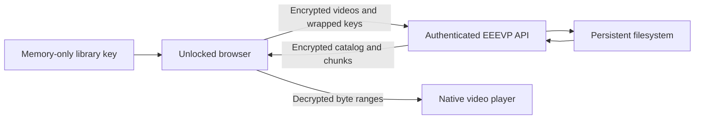

# EEEVP

**Your private video library, encrypted and played in your browser.**

EEEVP means **encrypted end-to-end video player**. Sign in to your library, unlock it with your encryption key, and watch your videos. The server stores an encrypted catalog and video files; your browser holds the key.

## Run locally

Install Docker with Docker Compose. Copy the configuration, set independent random values for the library password and session secret, then start the app:

```sh
cp .env.example .env.development
${EDITOR:-vi} .env.development
docker compose up --build -d
```

Open [localhost:3000](http://localhost:3000) and sign in with the configured library password. On first use, create the library encryption key and save its recovery copy before confirming. This key is separate from the sign-in password and cannot be recovered by the server.

## One library, your key

- **Access your complete library.** Sign in and enter the same encryption key on another device to see your uploaded videos.
- **Encrypt before upload.** A dedicated browser worker encrypts video chunks, filename, and media type with AES-256-GCM. Each video key is encrypted under your library key.
- **Watch and seek.** A browser service worker decrypts requested chunks and streams them to the native video player.
- **Lock when finished.** The encryption key lives in memory. Reloading requires entering it again; locking also ends the authenticated session.
- **Manage your videos.** Browse and search decrypted filenames locally, upload supported files, or permanently delete a video after confirmation.
- **Host on a small server.** One Next.js service keeps the catalog and encrypted files on a persistent filesystem.

Videos must be larger than zero bytes and at most 2 GiB. Playback uses the original MP4 or WebM file, so its codecs must be supported by the viewer's browser.

## How it works



The library key is never sent to the server or saved by the app in browser storage. Keep a recovery copy in a trusted place: losing it loses access to the videos. Application JavaScript and unlocked devices must be trusted. Read the [security model](docs/security.md) before storing sensitive content.

## Development and hosting

Run JavaScript tooling inside the Compose service:

```sh
docker compose exec -T web yarn biome:check
docker compose exec -T web yarn typecheck
docker compose exec -T web yarn test
```

Install Chromium and its system dependencies in the development container before running browser tests. Repeat the install after recreating that container:

```sh
docker compose exec -T web yarn playwright install --with-deps chromium
docker compose exec -T web yarn test:browser
```

See [deployment](docs/deployment.md) for a persistent Synteq VPS, HTTPS setup, backups, and production checks. The [architecture](docs/architecture.md) describes storage, worker boundaries, and the API.
